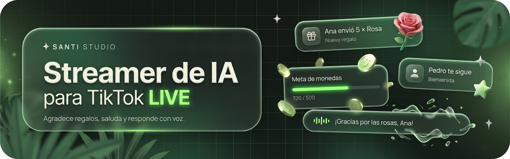

<p align="center">
  
</p>

<p align="center">
  <a href="https://www.youtube.com/@SantiStudioOficial"></a>
  
  
  
</p>

Crea tu propio personaje animado con IA que **agradece regalos, da la bienvenida a tus nuevos seguidores y responde comentarios en tiempo real**, con voz, subtítulos, metas y avisos en pantalla. Todo con herramientas gratuitas.

Proyecto del tutorial de **Santi Studio** en YouTube ([@SantiStudioOficial](https://www.youtube.com/@SantiStudioOficial)).

## Qué hace

| | |
|---|---|
| **Regalos** | Agradece cada regalo por su nombre y le responde su siguiente mensaje a quien regaló. |
| **Seguidores** | Da la bienvenida a quienes te siguen y agrupa a varios en una sola frase. |
| **Voz** | Habla con voz natural y mueve la boca sincronizada con la voz. |
| **Subtítulos** | Se escriben al ritmo de la voz, con un panel de "respondiendo a…". |
| **Metas** | Metas de monedas y de seguidores que el personaje celebra al cumplirse. |
| **Filtros** | Contra groserías y nombres ofensivos, con reglas para público que puede incluir menores. |
| **Respaldo** | Si una IA falla o llega a su límite, usa la siguiente; si todas fallan, usa frases de respaldo. El live nunca se queda mudo. |

## Qué necesitas

| Herramienta | Para qué |
|---|---|
| PC con **Windows** | Correr el proyecto. |
| **Python 3.10 o más nuevo** ([python.org](https://www.python.org/downloads/)) | Al instalar, marca **"Add python.exe to PATH"**. |
| Cuenta de TikTok con acceso a LIVE y **TikTok LIVE Studio** | Transmitir. |
| **TikFinity Desktop** ([tikfinity.zerody.one](https://tikfinity.zerody.one)) | Leer los eventos del live. Necesitas la app de escritorio, no solo la web. |
| **OBS Studio** | La cámara virtual. |
| Key gratuita de **Gemini** ([aistudio.google.com](https://aistudio.google.com)) | La IA que responde. |
| Key gratuita de **Groq** ([console.groq.com](https://console.groq.com)) | Respaldo, muy recomendado. |
| **DeepSeek** (o cualquier IA de texto) y **Google Flow** | Crear al personaje: imagen y videos. |

## Pasos

### 1. Crea tu personaje

Abre un chat nuevo en DeepSeek y pega el **[prompt maestro](#prompt-maestro)** (está al final de esta página y en la descripción del video). Te guía en 4 etapas: diseño, personalidad, imagen y animaciones.

### 2. Anima a tu personaje

En Flow, genera la imagen y luego los dos videos que te da DeepSeek: **reposo** y **hablando**. Descárgalos y renómbralos exactamente `reposo.mp4` y `hablando.mp4`.

> [!TIP]
> Activa en Windows **Ver → Mostrar → Extensiones de nombre de archivo**. Si no, tus videos pueden quedar como `reposo.mp4.mp4` y no funcionarán.

### 3. Prepara la carpeta

1. Descarga este proyecto: botón verde **Code → Download ZIP** y descomprímelo.
2. Mete tus dos videos en la carpeta.
3. Abre `personalidad.txt` con el Bloc de notas y pega la personalidad de la Etapa 2 (borra el texto que trae).
4. Abre `configuracion.txt` y pega:
   - Tu key en `GEMINI_KEY =` (y la de Groq en `GROQ_KEY =`).
   - Las 3 líneas de voz que te dio DeepSeek (`VOZ`, `VELOCIDAD`, `TONO`).
5. Opcional: una pista **libre de derechos** llamada `musica.mp3`.

> [!CAUTION]
> Tus keys son personales. No compartas tu `configuracion.txt` ni lo subas a internet una vez que tenga tus keys.

### 4. Pruébalo

1. Doble clic en **`iniciar`**. La primera vez instala lo necesario. Si Windows muestra un aviso de protección: **Más información → Ejecutar de todas formas**.
2. Abre `localhost:8765` en Chrome y **da un clic en la página** para activar el sonido.
3. Escribe comandos en la ventana negra:

| Comando | Qué simula |
|---|---|
| `r Ana Rosa 5` | Ana te manda 5 rosas |
| `r Luis León` | Un regalo grande |
| `f Pedro` | Pedro te sigue |
| `c Ana cuéntame una leyenda` | Ana te escribe (solo responde si antes mandó regalo) |
| `d Hola a todos` | El personaje dice ese texto tal cual (también en vivo) |
| `v es-MX-JorgeNeural -8% -4Hz` | Prueba otra voz |
| `meta 0` | Reinicia las metas |

Cierra la pestaña de Chrome cuando termines de probar.

### 5. Arma la escena

**OBS**
- Ajustes → Vídeo: base y salida en **1080x1920**.
- Fuente **Navegador**: URL `http://127.0.0.1:8765/visor.html?live=1`, ancho 1080, alto 1920. **Desmarca "Controlar audio vía OBS"**.
- **Iniciar Cámara Virtual** (no "Iniciar Transmisión").

**TikTok LIVE Studio**
- Cámara: **OBS Virtual Camera**. Micrófono silenciado, altavoces encendidos.
- Deja una sola copia del personaje: no tengas el visor abierto también en Chrome ni en una fuente de Enlace.

**TikFinity Desktop**
- Revisa que **Chat TTS esté desactivado** (si no, sonarán dos voces).

### 6. Sal en vivo

1. En `configuracion.txt` cambia `MODO = prueba` por `MODO = live` y vuelve a abrir `iniciar`.
2. Inicia el LIVE en LIVE Studio.
3. En TikFinity dale a **Conectar a TikTok LIVE**. La ventana negra debe decir **"Conectado a TikFinity"**.

> [!IMPORTANT]
> Durante el live deben estar abiertos: la ventana negra, OBS, LIVE Studio y TikFinity.

## Cuentas nuevas en LIVE Studio

Si tu cuenta es nueva en LIVE Studio, es probable que TikTok te pida cosas extra (las cuentas con más historial normalmente ya las tienen desbloqueadas):

- **No te deja iniciar sin una cámara.** Usa la cámara de tu celular (LIVE Studio te da un código QR) y agrega el personaje con una fuente **Enlace** en `http://127.0.0.1:8765/visor.html?live=1`. Deja tu cámara visible en una esquina.
- **La cámara virtual de OBS está bloqueada** hasta que hagas un live de **25 minutos o más** desde LIVE Studio. La validación puede tardar hasta 48 horas.
- **Periodo de prueba de 14 días**: una suspensión en ese tiempo te quita el acceso a LIVE Studio. Ten cuidado.

## Problemas comunes

| Problema | Solución |
|---|---|
| "No encuentro Python" | Reinstala Python marcando "Add python.exe to PATH". |
| El visor se ve negro | Revisa que los videos se llamen exactamente `reposo.mp4` y `hablando.mp4`. |
| No se escucha | Da un clic en la página del visor. En OBS, desmarca "Controlar audio vía OBS". |
| Se escuchan dos voces | Hay dos visores abiertos (Chrome, OBS o un Enlace oculto en LIVE Studio). Deja solo uno. |
| LIVE Studio dice "URL no válida" | Usa `127.0.0.1` en lugar de `localhost`. |
| OBS muestra un personaje anterior | Propiedades del Navegador → "Actualizar la caché de la página actual". |
| "El puerto 8765 está ocupado" | Ya hay otra ventana negra abierta. Ciérrala. |
| Responde con "frases de respaldo" | Las IA gratuitas están saturadas o tu key está mal copiada. Lee el AVISO que aparece en la ventana negra. Configura Groq. |
| La boca se detiene a media frase | El visor salta las pausas solo, pero si se nota mucho, regenera el video de hablando. |
| "personalidad.txt está vacío" | Pega la personalidad de DeepSeek y borra el texto entre corchetes. |

Todas las opciones (metas, letreros, subtítulos, filtros, música, posiciones) se explican dentro de `configuracion.txt`. Cada vez que cambies algo, cierra la ventana negra y abre `iniciar` de nuevo.

## Archivos del proyecto

| Archivo | Qué es |
|---|---|
| `iniciar.bat` | Instala lo necesario y arranca el streamer. |
| `configuracion.txt` | Tus keys, voz, metas, filtros y todas las opciones. |
| `personalidad.txt` | La personalidad de tu personaje. |
| `script.py` | El programa: lee el live, genera las respuestas y la voz. |
| `visor.html` | Lo que se ve en pantalla: personaje, subtítulos, metas y avisos. |

## Recomendaciones y responsabilidad

Este proyecto es educativo. **Cómo y dónde lo uses es tu decisión y tu responsabilidad**; aquí te dejo lo que aprendí en las pruebas para que decidas informado:

- TikTok puede limitar lives que parezcan **pregrabados**. Personajes con más movimiento y los elementos en vivo en pantalla ayudan, pero no hay garantía.
- **Etiqueta tu contenido como generado con IA**, sobre todo si tu personaje es realista.
- No uses **personajes, voces ni música con derechos de autor**.
- Mantén los filtros activos: tu público puede incluir menores.
- Los servicios gratuitos (Gemini, Groq, la voz de Microsoft) **pueden cambiar sus límites o fallar**. Revisa tus límites en AI Studio.

Herramientas de terceros que usa este proyecto: TikFinity, edge-tts (voz no oficial de Microsoft), Gemini y Groq. Este proyecto no está afiliado a TikTok ni a ninguna de ellas.

## Prompt maestro

Pega esto en un chat nuevo de DeepSeek. Usa el botón de copiar de la esquina del bloque para copiarlo completo.

```
Actúa como mi asistente para crear un personaje animado con IA para lives de TikTok. Guíame por etapas, una a la vez, y espera mi respuesta donde se indique. No te adelantes de etapa ni cambies decisiones que ya aprobé.

INICIO. Saluda en una línea y pregunta: «¿Qué personaje quieres crear? Escribe su nombre o descríbelo como quieras». Espera.

ETAPA 1. Revisa si mi personaje tiene dueño (películas, series, videojuegos, marcas o personas reales). Si lo tiene, avísame en una línea y propón 3 alternativas originales o de dominio público con una esencia parecida. Si es libre, propón 3 versiones con diseño propio y estilos distintos (por ejemplo: 3D estilizado, ilustración, realista), sin copiar diseños famosos. Preséntalas numeradas, con una descripción visual breve, y pregunta: «¿Cuál eliges? Responde con un número». Espera.

ETAPA 2. Ponle un nombre corto y fácil de recordar, y escribe en un bloque de código su personalidad para la IA que lo controlará, en segunda persona («Eres [nombre]…»): quién es, dónde vive, qué le gusta, cómo habla, algunas frases típicas y cómo reacciona a regalos pequeños y grandes. Incluye estas reglas:
- Respondes en máximo 2 frases cortas, dices el nombre de quien te escribe y, si te mandó un regalo, mencionas cuál.
- Usas tus frases típicas solo de vez en cuando y varías tus respuestas.
- Nunca rompes el personaje. Si alguien pregunta en serio si eres una IA, lo admites con humor.
- Tu público puede incluir menores: nada de coqueteo, groserías, insultos, contenido sexual, drogas, política ni religión. Si te provocan, cambias de tema con humor.
- No pides regalos con insistencia ni prometes nada.
- No usas emojis, asteriscos ni descripciones de acciones, porque todo se lee en voz alta.
Debajo, en otro bloque de código, escribe su voz eligiendo la más adecuada de esta lista: es-MX-DaliaNeural (mujer, México), es-MX-JorgeNeural (hombre, México), es-US-PalomaNeural (mujer, Latinoamérica), es-US-AlonsoNeural (hombre, Latinoamérica), es-ES-XimenaNeural (mujer, España), es-ES-AlvaroNeural (hombre, España). Usa este formato, con velocidad entre -15% y +10% y tono entre -10Hz y +10Hz:
VOZ = …
VELOCIDAD = …
TONO = …
Dime: «Pega la personalidad en personalidad.txt y la voz en configuracion.txt. Escribe SIGUIENTE para crear la imagen». Espera.

ETAPA 3. Escribe en un bloque de código un prompt de imagen vertical, autónomo y detallado, que empiece con la línea «Genera 4 imágenes diferentes con este prompt:». Describe al personaje con el diseño elegido, centrado y de frente. Si tiene cara: plano medio de la cintura para arriba, mirando a la cámara, con la boca cerrada y una sonrisa leve, y las manos fuera de cuadro o quietas y juntas al frente. Si no tiene cara (objeto, orbe, logo, robot sin rostro): completo y en reposo. El primer tercio superior de la imagen debe ser solo fondo o la parte más alta de la cabeza, y su cara, o su centro si no tiene cara, queda cerca de la mitad de la imagen. Detrás, un escenario sencillo con 1 o 2 elementos que se muevan en su lugar (por ejemplo la llama de una vela, una luz que parpadea, humo o tela), sin objetos cayendo ni flotando y sin nada que distraiga. Iluminación suave. Sin texto, logotipos ni marcas de agua.
Dime: «Elige la imagen que más te guste: el personaje completo, sin cortes ni deformaciones. Escribe SIGUIENTE para crear las animaciones». Espera.

ETAPA 4. Escribe dos prompts de video adaptados a mi personaje, cada uno en su propio bloque de código y empezando con la línea «Genera un video de 6 segundos con este prompt. Usa la imagen como primer fotograma y también como último fotograma:». Los dos incluyen siempre: cámara completamente fija, sin zoom ni paneo; el video termina en la misma postura y encuadre del inicio para repetirse en bucle; si tiene manos, se quedan quietas; el fondo se mueve en su lugar, suave y lento; no se agregan ni eliminan objetos ni cambia el diseño.
1. REPOSO: tranquilo y en silencio, sin voz ni música, solo un sonido ambiente muy suave, con movimiento suave pero continuo, nunca completamente quieto. Si tiene cara, respiración suave, un leve movimiento de cabeza y un parpadeo lento, con la boca cerrada e inmóvil todo el video. Si no tiene cara, una pulsación o rotación lenta.
2. HABLANDO: como si hablara sin parar, sin voz ni música, empezando a moverse desde el primer instante y sin detenerse hasta el último medio segundo. Si tiene boca, la abre y la cierra con naturalidad todo el video, con pequeños gestos amables. Si no tiene boca, pulsa, vibra u ondula con más intensidad y ritmo variado, como un visualizador de audio.
Antes de los bloques dime: «Arrastra al chat de Flow la imagen que elegiste, pega el prompt de REPOSO y revisa el video antes de generar el de HABLANDO». Después de los bloques dime: «Descarga los videos y renómbralos reposo.mp4 y hablando.mp4 (revisa que no queden como reposo.mp4.mp4)».

Empieza ahora con el INICIO.
```

---

<p align="center"><sub>IA explicada simple, sin rodeos. · <a href="https://www.youtube.com/@SantiStudioOficial">youtube.com/@SantiStudioOficial</a></sub></p>
